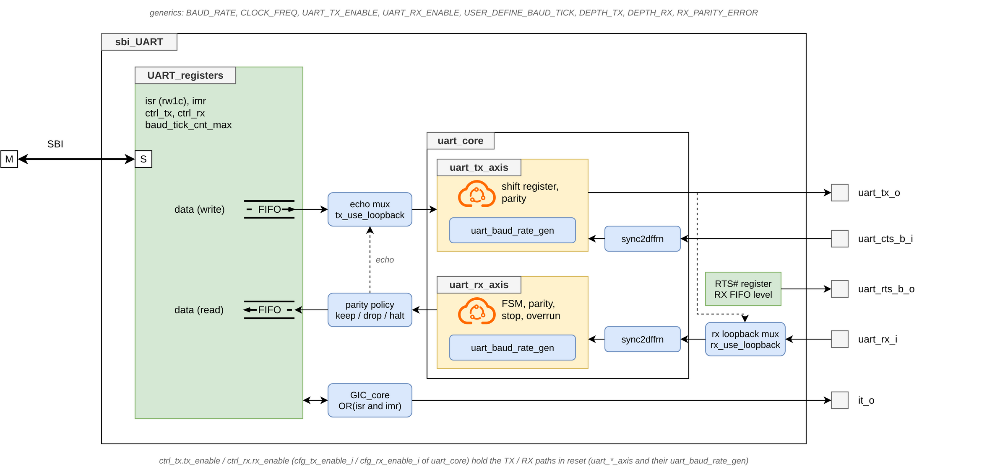
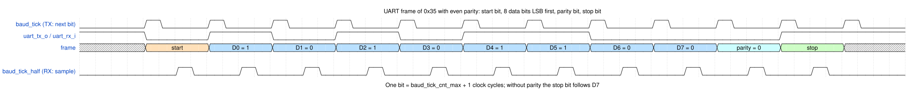
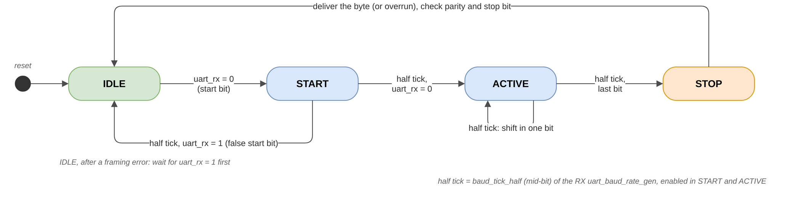

<!--
  README MODEL (common to every Asylum IP, keep the same headings)
  ----------------------------------------------------------------
  Regenerate from the sources, never from the previous README text alone:
    hdl/*.vhd (entities, generics, ports), hdl/csr/*.hjson (register map),
    <IP>.core (VLNV, targets, depends), mk/targets.txt, sim/, syn/, esw/.
  Sections, in this order:
    badges / title + one-line pitch / Overview / Features / Block Diagram /
    Getting Started / Hardware Interfaces / Configuration / Resources /
    Theory of Operation / Registers / Programmer's Guide /
    Design Verification / Dependencies and Related IPs / License
  Rules:
    - English, short and factual: every statement backed by the sources.
    - No VLNV line: the version badge shows it.
    - Badges: first line version, license; second line CI, lint, sim, syn.
    - Block diagram and FSM: pages Overview and FSM of doc/<NAME>.drawio, exported to
      doc/<NAME>-Overview.png and doc/<NAME>-FSM.png (make -C doc).
    - Timing diagrams: WaveDrom source doc/<NAME>-<what>.json, rendered
      doc/<NAME>-<what>.svg (make -C doc), shown as images.
    - No CPU named (OpenBlaze, PicoBlaze, RISC-V) outside the CPU and SoC IPs.
    - Registers: link to the generated hdl/csr/<X>_csr.md, never copy the tables.
    - Tables: Configuration = Name|Type|Default|Description,
      Hardware Interfaces = Name|Direction|Type|Description, grouped by interface.
    - A section with nothing to say is one line ("This IP has no
      software-visible registers."), never removed.
-->
[](https://github.com/deuskane/asylum-communication-uart/tags)
[](LICENSE)

[](https://github.com/deuskane/asylum-communication-uart/actions/workflows/ci.yml)
[](https://github.com/deuskane/asylum-communication-uart/actions/workflows/ci.yml)
[](https://github.com/deuskane/asylum-communication-uart/actions/workflows/ci.yml)
[](https://github.com/deuskane/asylum-communication-uart/actions/workflows/ci.yml)

# UART

**A small, readable UART in VHDL: TX and RX FIFOs, even / odd parity, CTS# / RTS# flow control, RX error detection and 8 interrupt sources, verified with UVVM.**

Part of the [Asylum project](https://github.com/deuskane/asylum-project), a collection of small IP cores, written to be read and learned from.

## Table of Contents

1. [Overview](#overview)
2. [Features](#features)
3. [Block Diagram](#block-diagram)
4. [Getting Started](#getting-started)
5. [Hardware Interfaces](#hardware-interfaces)
6. [Configuration](#configuration)
7. [Resources](#resources)
8. [Theory of Operation](#theory-of-operation)
9. [Registers](#registers)
10. [Programmer's Guide](#programmers-guide)
11. [Design Verification](#design-verification)
12. [Dependencies and Related IPs](#dependencies-and-related-ips)
13. [License](#license)

## Overview

This IP is an asynchronous serial port (UART) with 8-bit frames. Software drives it through seven 8-bit registers on the SBI bus (the simple bus of Asylum):

- a byte written to `data` goes through a TX FIFO to the transmitter `uart_tx_axis`,
- a byte received by `uart_rx_axis` is pushed into an RX FIFO and read back from the same `data` register,
- the FIFO state and the receive errors are the 8 sources of an interrupt controller (`isr`, `imr`, `it_o`), also read by polling.

The transmitter and the receiver have AXI-Stream-like valid/ready interfaces, their own baud rate generator, enable and parity configuration. They form `uart_core`, a UART without registers that a design can also use alone (see [uart_core](#uart_core-uart-without-registers)).

## Features

- Frame: 1 start bit, 8 data bits LSB first, optional parity bit (even or odd), 1 stop bit
- Baud rate `f_clk / (baud_tick_cnt_max + 1)`: reset value from the generics `CLOCK_FREQ` / `BAUD_RATE`, software-writable 16-bit divider (`USER_DEFINE_BAUD_TICK`); the receiver samples each bit in its middle and needs at least 8 clock cycles per bit
- Separate TX and RX enables, each one the reset of its path; bytes written while TX is disabled stay in the TX FIFO
- Configurable FIFO depths (`DEPTH_TX`, `DEPTH_RX`, 0 = no FIFO), blocking read / write of `data`
- Hardware flow control: CTS# gates the transmitter, RTS# deasserted at `DEPTH_RX - 2` bytes in the RX FIFO
- RX checks: false start bit (glitch) rejected, parity error, framing error (stop bit at 0), break, overrun (the pending byte is kept)
- Policy on a byte with a parity error (`RX_PARITY_ERROR`): keep it, drop it, or keep it and halt RX until software has seen it
- Serial loopback (TX to RX) and echo mode (received bytes sent back), for self-test
- 8 interrupt sources: TX FIFO empty / full, RX FIFO not empty / full, RX overrun, framing error, parity error, break
- TX or RX path removable at elaboration (`UART_TX_ENABLE`, `UART_RX_ENABLE`)
- `uart_core`: transmitter and receiver with their baud rate generators and the synchronizers of the asynchronous inputs, without registers, for a standalone use; a removed direction (`TX_ENABLE`, `RX_ENABLE`) has no logic and constant outputs
- Simulation only: dump of the sent and received bytes to text files

## Block Diagram



## Getting Started

The cores of the Asylum IPs are published in the FuseSoC library [asylum-cores](https://github.com/deuskane/asylum-cores) (with the UVVM core used by the testbenches):

```bash
pip install fusesoc
fusesoc library add https://github.com/deuskane/asylum-cores
fusesoc run --target sim_basic_rx asylum:communication:uart  # needs GHDL
```

To use the IP in your design, add `asylum:communication:uart` to the `depend` list of your core and instantiate `sbi_UART` (library `asylum`):

```vhdl
library asylum;
use     asylum.sbi_pkg.all;
use     asylum.uart_pkg.all;

  ins_uart : sbi_UART
    generic map
    ( NAME                  => "UART0"
     ,BAUD_RATE             => 115200
     ,CLOCK_FREQ            => 50000000
     ,DEPTH_TX              => 16
     ,DEPTH_RX              => 16
    )
    port map
    ( clk_i        => clk
     ,arst_b_i     => arst_b
     ,sbi_ini_i    => sbi_ini        -- 3 address bits, 8-bit data
     ,sbi_tgt_o    => sbi_tgt
     ,uart_tx_o    => uart_tx
     ,uart_rx_i    => uart_rx
     ,uart_cts_b_i => uart_cts_b
     ,uart_rts_b_o => uart_rts_b
     ,it_o         => it_uart
     ,debug_o      => open
    );
```

[PicoSoC](https://github.com/deuskane/asylum-soc-picosoc) is a complete example: it connects this IP to a CPU, with its software driver.

## Hardware Interfaces

Top-level entity: **`sbi_UART`** ([hdl/sbi_uart.vhd](hdl/sbi_uart.vhd)), component in `asylum.uart_pkg`.

### Clock and Reset

| Name | Direction | Type | Description |
|------|-----------|------|-------------|
| `clk_i` | in | std_logic | System clock, the only clock of the IP |
| `arst_b_i` | in | std_logic | Asynchronous reset, active low |

### Bus (SBI)

| Name | Direction | Type | Description |
|------|-----------|------|-------------|
| `sbi_ini_i` | in | sbi_ini_t | Request from the initiator (`cs`, `re`, `we`, `addr`, `wdata`); 3 address bits, 8-bit data |
| `sbi_tgt_o` | out | sbi_tgt_t | Response to the initiator (`ready`, `rdata`, `info`) |

### UART

| Name | Direction | Type | Description |
|------|-----------|------|-------------|
| `uart_tx_o` | out | std_logic | Serial data output, idle high |
| `uart_rx_i` | in | std_logic | Serial data input, idle high; synchronized in the IP (`sync2dffrn`, idle level kept during reset) |
| `uart_cts_b_i` | in | std_logic | Clear To Send, active low; synchronized in the IP, used when `ctrl_tx.cts_enable = 1` |
| `uart_rts_b_o` | out | std_logic | Request To Send, active low, registered (reset value `'0'`): `'0'` when `ctrl_rx.rts_enable = 0`, else `'1'` when the RX FIFO holds `max(DEPTH_RX - 2, 1)` bytes or more (`DEPTH_RX = 0`: while a received byte is pending) or while RX is halted (`RX_PARITY_ERROR = "halt"`) |

The asynchronous inputs are synchronized inside the IP: connect them directly to the pads.

### Interrupt

| Name | Direction | Type | Description |
|------|-----------|------|-------------|
| `it_o` | out | std_logic | Interrupt request: OR of the `isr` bits enabled in `imr` |

### Debug

| Name | Direction | Type | Description |
|------|-----------|------|-------------|
| `debug_o` | out | uart_debug_t | `uart_tx.state` (TX active), `uart_rx.state` (receiver FSM state), `uart_rx.bit_cnt` (4 LSB of the bit counter), `uart_rx.baud_tick_half`, `uart_rx.parity_error` (parity error of the last received frame) |

### uart_core: UART without registers

[hdl/uart_core.vhd](hdl/uart_core.vhd), component in `asylum.uart_pkg`: the transmitter `uart_tx_axis` and the receiver `uart_rx_axis`, each with its `uart_baud_rate_gen`, as in `sbi_UART`, and the synchronizers of `uart_rx_i` and `uart_cts_b_i`, without registers, FIFOs or interrupts. `sbi_UART` is built on it.

| Generic | Type | Default | Description |
|---------|------|---------|-------------|
| `TX_ENABLE` | boolean | `true` | `false`: no transmitter, its outputs are constants (table below) |
| `RX_ENABLE` | boolean | `true` | `false`: no receiver, its outputs are constants (table below) |
| `WIDTH` | natural | `8` | Data bits per frame |
| `BAUD_TICK_CNT_WIDTH` | natural | `16` | Width of `cfg_baud_tick_cnt_max_i` |

| Name | Direction | Type | Description |
|------|-----------|------|-------------|
| `clk_i` | in | std_logic | Clock |
| `arst_b_i` | in | std_logic | Asynchronous reset, active low |
| `cfg_baud_tick_cnt_max_i` | in | std_logic_vector(BAUD_TICK_CNT_WIDTH-1 downto 0) | Clock cycles per bit - 1, for TX and RX; at least 7 with the receiver (8 clock cycles per bit, see [Sampling point](#sampling-point)); change it while both directions are disabled |
| `cfg_tx_enable_i` / `cfg_rx_enable_i` | in | std_logic | `'0'`: the direction is held in reset (its reset is `arst_b_i and cfg_<dir>_enable_i`) |
| `cfg_tx_parity_enable_i` / `cfg_tx_parity_odd_i` | in | std_logic | TX parity bit; 0: even, 1: odd |
| `cfg_rx_parity_enable_i` / `cfg_rx_parity_odd_i` | in | std_logic | RX parity bit, sampled at the start of each frame; 0: even, 1: odd |
| `s_axis_tdata_i` / `s_axis_tvalid_i` / `s_axis_tready_o` | in / in / out | std_logic_vector(WIDTH-1 downto 0) / std_logic / std_logic | Byte to send; ready when the transmitter is enabled, idle and CTS# is low |
| `uart_tx_o` | out | std_logic | Serial output, idle high |
| `uart_cts_b_i` | in | std_logic | Clear To Send, active low: a new frame starts only when `'0'`; asynchronous, synchronized inside |
| `uart_rx_i` | in | std_logic | Serial input, idle high; asynchronous, synchronized inside |
| `m_axis_tdata_o` / `m_axis_tvalid_o` / `m_axis_tready_i` | out / out / in | std_logic_vector(WIDTH-1 downto 0) / std_logic / std_logic | Received byte; every byte is delivered, except a byte dropped by an overrun |
| `m_axis_parity_error_o` | out | std_logic | Parity error of the byte on `m_axis_tdata_o` |
| `err_overrun_o` / `err_parity_o` / `err_framing_o` / `err_break_o` | out | std_logic | One-cycle pulses at the end of a frame: byte dropped because the previous one is pending, parity bit mismatch, stop bit at 0, every bit at 0 |
| `debug_o` | out | uart_debug_t | Same record as `sbi_UART` |

`uart_rx_i` and `uart_cts_b_i` are asynchronous: connect them directly to the pads. Each one goes through a `sync2dffrn` of `asylum:target:techmap` (2 clock cycles of latency) when its direction exists: `uart_rx_i` with `RX_ENABLE`, `uart_cts_b_i` with `TX_ENABLE`. `uart_rx_i` is inverted around its synchronizer (reset to `'0'`), so that the receiver sees the idle level `'1'` during the reset. A loopback of `uart_tx_o` to `uart_rx_i` goes through the synchronizer too (2 clock cycles).

Outputs of a removed direction:

| Generic | Output | Value | Why |
|---------|--------|-------|-----|
| `TX_ENABLE = false` | `uart_tx_o` | `'1'` | Idle line |
| | `s_axis_tready_o` | `'1'` | The bytes are accepted and dropped: a producer never blocks (a blocking write to `data` of `sbi_UART` without transmitter completes) |
| | `debug_o.uart_tx` | all `'0'` | |
| `RX_ENABLE = false` | `m_axis_tvalid_o` | `'0'` | No byte |
| | `m_axis_tdata_o`, `m_axis_parity_error_o` | all `'0'` | |
| | `err_overrun_o`, `err_parity_o`, `err_framing_o`, `err_break_o` | `'0'` | No error |
| | `debug_o.uart_rx` | all `'0'` | |

The inputs of a removed direction are ignored. Example: a transmitter only, at 115200 baud from a 50 MHz clock, no parity, CTS# ignored:

```vhdl
library ieee;
use     ieee.numeric_std.all;
library asylum;
use     asylum.uart_pkg.all;

  ins_uart_core : uart_core
    generic map
    (TX_ENABLE               => true
    ,RX_ENABLE               => false
    )
    port map
    (clk_i                   => clk
    ,arst_b_i                => arst_b
    ,cfg_baud_tick_cnt_max_i => std_logic_vector(to_unsigned(50000000/115200-1, 16))
    ,cfg_tx_enable_i         => '1'
    ,cfg_tx_parity_enable_i  => '0'
    ,cfg_tx_parity_odd_i     => '0'
    ,cfg_rx_enable_i         => '0'
    ,cfg_rx_parity_enable_i  => '0'
    ,cfg_rx_parity_odd_i     => '0'
    ,s_axis_tdata_i          => tx_tdata
    ,s_axis_tvalid_i         => tx_tvalid
    ,s_axis_tready_o         => tx_tready
    ,uart_tx_o               => uart_tx
    ,uart_cts_b_i            => '0'
    ,uart_rx_i               => '1'
    ,m_axis_tdata_o          => open
    ,m_axis_parity_error_o   => open
    ,m_axis_tvalid_o         => open
    ,m_axis_tready_i         => '1'
    ,err_overrun_o           => open
    ,err_parity_o            => open
    ,err_framing_o           => open
    ,err_break_o             => open
    ,debug_o                 => open
    );
```

<details>
<summary><b>uart_tx_axis, uart_rx_axis, uart_baud_rate_gen</b>: transmitter, receiver and baud rate generator, for a standalone use without the registers</summary>

Components in `asylum.uart_pkg`, generic `WIDTH` (8) for the transmitter and the receiver, `BAUD_TICK_CNT_WIDTH` (16) for the baud rate generator. In `uart_core`, `arst_b_i` of a path is `arst_b_i and cfg_<dir>_enable_i` (`ctrl_tx.tx_enable` / `ctrl_rx.rx_enable` in `sbi_UART`).

[hdl/uart_tx_axis.vhd](hdl/uart_tx_axis.vhd):

| Name | Direction | Type | Description |
|------|-----------|------|-------------|
| `s_axis_tdata_i` / `s_axis_tvalid_i` / `s_axis_tready_o` | in / in / out | std_logic_vector(WIDTH-1 downto 0) / std_logic / std_logic | Byte to send; ready when the transmitter is out of reset, idle and CTS# is low |
| `uart_tx_o` | out | std_logic | Serial output (reset value `'1'`) |
| `uart_cts_b_i` | in | std_logic | A new frame starts only when `'0'` |
| `baud_tick_i` | in | std_logic | One bit shifted out per tick |
| `parity_enable_i` / `parity_odd_i` | in | std_logic | Parity bit inserted before the stop bit; 0: even, 1: odd |
| `debug_o` | out | uart_tx_debug_t | `state`: transmitter active |

[hdl/uart_rx_axis.vhd](hdl/uart_rx_axis.vhd):

| Name | Direction | Type | Description |
|------|-----------|------|-------------|
| `uart_rx_i` | in | std_logic | Serial input (already synchronized) |
| `m_axis_tdata_o` / `m_axis_tvalid_o` / `m_axis_tready_i` | out / out / in | std_logic_vector(WIDTH-1 downto 0) / std_logic / std_logic | Received byte, every byte is delivered (except a byte dropped by an overrun) |
| `m_axis_parity_error_o` | out | std_logic | Parity error of the byte on `m_axis_tdata_o`; the policy is applied by the sink |
| `baud_tick_i` / `baud_tick_half_i` | in | std_logic | Baud ticks (the line is sampled on the clock edge after `baud_tick_half_i`, mid-bit) |
| `baud_tick_en_o` | out | std_logic | Enable of the baud rate generator (START and ACTIVE states) |
| `parity_enable_i` / `parity_odd_i` | in | std_logic | Parity configuration, sampled at the start of each frame |
| `last_parity_error_o` | out | std_logic | Parity status of the last received frame (debug) |
| `err_overrun_o` | out | std_logic | One-cycle pulse: a frame received while the previous byte is still pending, the new byte is dropped |
| `err_parity_o` / `err_framing_o` / `err_break_o` | out | std_logic | One-cycle pulses at the end of a frame: parity bit mismatch, stop bit at 0, every bit at 0 |
| `debug_o` | out | uart_rx_debug_t | FSM state, bit counter, `baud_tick_half`, `parity_error` |

[hdl/uart_baud_rate_gen.vhd](hdl/uart_baud_rate_gen.vhd):

| Name | Direction | Type | Description |
|------|-----------|------|-------------|
| `baud_tick_en_i` | in | std_logic | Enable; the counter is loaded with `cfg_baud_tick_cnt_max_i` on its rising edge |
| `baud_tick_o` | out | std_logic | One-cycle pulse every `cfg_baud_tick_cnt_max_i + 1` cycles |
| `baud_tick_half_o` | out | std_logic | One-cycle pulse when the counter is at `cfg_baud_tick_cnt_max_i / 2 + UART_RX_LATENCY` (4, `uart_pkg`): sampling point of the receiver, in the middle of the bit (see [Sampling point](#sampling-point)); never with less than 8 clock cycles per bit |
| `cfg_baud_tick_cnt_max_i` | in | std_logic_vector(BAUD_TICK_CNT_WIDTH-1 downto 0) | Reload value of the down counter |

</details>

## Configuration

Generics of `sbi_UART`:

| Name | Type | Default | Description |
|------|------|---------|-------------|
| `NAME` | string | `""` | Instance name, visible in `sbi_tgt_o.info` |
| `BAUD_RATE` | integer | `115200` | Baud rate (bit/s) of the reset value of `baud_tick_cnt_max`; the receiver needs `CLOCK_FREQ / BAUD_RATE >= 8` |
| `CLOCK_FREQ` | integer | `50000000` | Frequency of `clk_i` in Hz |
| `BAUD_TICK_CNT_WIDTH` | integer | `16` | Width of the baud rate counters; keep 16, the width of `baud_tick_cnt_max_msb & baud_tick_cnt_max_lsb` |
| `UART_TX_ENABLE` | boolean | `true` | `false`: no transmitter (`uart_tx_o = '1'`, writes to `data` accepted and dropped) |
| `UART_RX_ENABLE` | boolean | `true` | `false`: no receiver (RX FIFO never written, `uart_rts_b_o = '0'`) |
| `USER_DEFINE_BAUD_TICK` | boolean | `true` | `true`: `baud_tick_cnt_max_lsb` / `_msb` are software-writable; `false`: the divider is fixed to `CLOCK_FREQ / BAUD_RATE - 1` |
| `DEPTH_TX` | natural | `0` | Depth of the TX FIFO (0 = no FIFO) |
| `DEPTH_RX` | natural | `0` | Depth of the RX FIFO (0 = no FIFO) |
| `RX_PARITY_ERROR` | string | `"keep"` | Byte received with a parity error: `"keep"` stored in the RX FIFO, `"drop"` dropped, `"halt"` stored then RX halted until `isr` bit 6 is cleared (see [Parity error policy](#parity-error-policy)); any other value fails at elaboration |
| `FILENAME_TX` / `FILENAME_RX` | string | `"dump_uart_tx.txt"` / `"dump_uart_rx.txt"` | Simulation only: raw dump of the sent / received bytes, annotated copy in `<FILENAME>.dbg` |

The FIFO depths set most of the area of the IP.

## Resources

Figures of the `syn_*` targets (`make nonreg_syn`, see [Targets](#targets)): [syn/sbi_UART_wrapper.vhd](syn/sbi_UART_wrapper.vhd) (`sbi_UART`) and [syn/uart_core_wrapper.vhd](syn/uart_core_wrapper.vhd) (`uart_core`, 8 data bits, 16-bit divider) with the generics of each configuration, synthesized by Yosys and its GHDL plugin; the reports are in the build directory of each target.

| Configuration | LUT¹ | LUTRAM¹ | FF¹ | CARRY4¹ | MUXF7/F8¹ | BRAM¹ | DSP¹ | Area² (µm²) | kGE³ |
|---|---|---|---|---|---|---|---|---|---|
| `syn_default` (default generics, no FIFO) | 225 | 0 | 146 | 12 | 42 | 0 | 0 | 6870.34 | 1.830 |
| `syn_fifo16` (FIFOs 16 / 16, as `tb_UART`) | 250 | 16 | 171 | 22 | 53 | 0 | 0 | 17799.57 | 4.742 |
| `syn_tx_only` (no receiver, TX FIFO 4) | 134 | 8 | 91 | 6 | 16 | 0 | 0 | 5142.43 | 1.370 |
| `syn_rx_only` (no transmitter, RX FIFO 4) | 141 | 8 | 113 | 11 | 24 | 0 | 0 | 6532.52 | 1.740 |
| `syn_fixed_baud` (no FIFO, fixed divider) | 196 | 0 | 130 | 8 | 9 | 0 | 0 | 5620.39 | 1.497 |
| `syn_parity_drop` (no FIFO, `RX_PARITY_ERROR = "drop"`) | 228 | 0 | 147 | 12 | 44 | 0 | 0 | 6924.14 | 1.845 |
| `syn_parity_halt` (no FIFO, `RX_PARITY_ERROR = "halt"`) | 228 | 0 | 146 | 12 | 49 | 0 | 0 | 6899.12 | 1.838 |
| `syn_core` (`uart_core`, TX and RX) | 161 | 0 | 103 | 12 | 39 | 0 | 0 | 4849.65 | 1.292 |
| `syn_core_tx_only` (`uart_core`, TX only) | 79 | 0 | 42 | 4 | 16 | 0 | 0 | 1845.52 | 0.492 |

¹ Xilinx Artix-7 (LUT6), Yosys 0.33 `synth_xilinx -flatten -noiopad -noclkbuf`, before place and route: every cell of the netlist is counted, Vivado may differ. Identical cells are merged as a vendor tool does (`opt_merge -share_all`): the inverters of an active-low reset net become one (the resets of the TX and RX paths, `arst_b_i and cfg_<dir>_enable_i` in `uart_core`, are reset nets too); every remaining cell is counted, an `INV` as a `LUT1` (32 of the 225 LUTs of `syn_default`, 33 of the 161 of `syn_core`). The FIFO storage is in LUTRAM (`RAM32M`), not in BRAM.

² SkyWater sky130 `sky130_fd_sc_hd`, typical corner (tt, 25 °C, 1.80 V), Yosys 0.33 `synth` + `dfflibmap` + `abc -liberty`: standard-cell area only, no timing constraint, no buffering, clock tree or placement; the FIFO storage becomes flip-flops (no SRAM macro).

³ Area in thousands of NAND2 gate equivalents (`sky130_fd_sc_hd__nand2_1` = 3.7536 µm²).

Since 3.2.0 the RX half tick compares the counter with `baud_tick_cnt_max / 2 + 4` (see [Sampling point](#sampling-point)): the adder costs 2 LUT and 4 `CARRY4` (ABC also maps 10 more `MUXF7` / `MUXF8`) and about 22 sky130 cells (+150 µm²) per receiver, and folds into a constant with a fixed divider (`syn_fixed_baud`); the flip-flops are unchanged.

## Theory of Operation

### Hierarchy

| File | Unit | Role |
|------|------|------|
| [hdl/sbi_uart.vhd](hdl/sbi_uart.vhd) | `sbi_UART` | Top level: registers, loopback and echo muxes, parity error policy, RTS#, `GIC_core`, simulation dumps |
| [hdl/uart_core.vhd](hdl/uart_core.vhd) | `uart_core` | Transmitter and receiver with their baud rate generators, synchronizers of `uart_rx_i` / `uart_cts_b_i`, enables, constant outputs of a removed direction |
| [hdl/uart_tx_axis.vhd](hdl/uart_tx_axis.vhd) | `uart_tx_axis` | Transmitter: shift register, parity, CTS# gating |
| [hdl/uart_rx_axis.vhd](hdl/uart_rx_axis.vhd) | `uart_rx_axis` | Receiver: FSM, parity, stop bit and overrun checks |
| [hdl/uart_baud_rate_gen.vhd](hdl/uart_baud_rate_gen.vhd) | `uart_baud_rate_gen` | Baud tick and mid-bit tick (one per direction) |
| [hdl/uart_pkg.vhd](hdl/uart_pkg.vhd) | `uart_pkg` | Components, debug record types |
| `hdl/csr/UART_csr.vhd` | `UART_registers` | Register bank and FIFOs, generated by regtool from [hdl/csr/UART.hjson](hdl/csr/UART.hjson) |

### Data path

`data` is a bidirectional FIFO register: a write pushes a byte in the TX FIFO, a read pops a byte from the RX FIFO. Both accesses are *blocking*: an access waits (holds the bus) until the FIFO can accept or provide the byte. The FIFOs talk to the transmitter and the receiver with valid/ready handshakes, so the transmitter simply waits for a byte and a received byte waits in the receiver while the RX FIFO is full.

### Frame and baud rate



Each direction has its own `uart_baud_rate_gen`, a down counter reloaded with `baud_tick_cnt_max`: one bit lasts `baud_tick_cnt_max + 1` clock cycles. The reset value of `baud_tick_cnt_max` is `CLOCK_FREQ / BAUD_RATE - 1` (integer division): 433 for 115200 baud at 50 MHz (115207 baud). The TX generator runs free and the transmitter shifts one bit per `baud_tick`. The RX generator starts on the falling edge of the start bit, and the receiver samples each bit at mid-bit (`baud_tick_half`), which tolerates a few percent of baud rate mismatch: ± 2 % with back-to-back frames from 8 to 434 clock cycles per bit, ± 3 % at 434 in simulation (the margin grows with the clock cycles per bit: with back-to-back frames, a sender 2 % faster to 5 % slower at 8 cycles per bit, 4 % faster to 5 % slower at 100 and 434).

`ctrl_tx.tx_enable` and `ctrl_rx.rx_enable` (`cfg_tx_enable_i` / `cfg_rx_enable_i` of `uart_core`) hold their path (transmitter or receiver and its generator) in reset: write `baud_tick_cnt_max` while both are 0.

### Sampling point

The receiver samples the line on the clock edge after `baud_tick_half`. With `N = baud_tick_cnt_max + 1` clock cycles per bit and the clock edges counted from the one where `uart_rx_axis` sees the start bit (edge 0):

| Edge | Event |
|------|-------|
| 0 | `uart_rx_axis` sees the start bit: IDLE to START |
| 1 | `baud_tick_en_o` = 1 |
| 2 | RX counter loaded with `baud_tick_cnt_max` |
| 3 + `baud_tick_cnt_max` - H | counter at `H`: `baud_tick_half` = 1 |
| 4 + `baud_tick_cnt_max` - H | start bit sampled (false start if `'1'`), then one bit every N cycles |

The middle of the start bit is at edge `N / 2` (integer division), so the half tick comes at `H = baud_tick_cnt_max / 2 + UART_RX_LATENCY`: `UART_RX_LATENCY` (4, in `uart_pkg`) compensates the 4 registers between the start bit seen and its sample. The line falls up to one clock cycle before edge 0: each bit is sampled between `N/2 - 1/2` and `N/2 + 1` clock cycles after its start (measured with the bits starting on a falling clock edge: 4.5 cycles at N = 8 and 9, 5.5 at 10, 6.5 at 13, 8.5 at 16, 50.5 at 100). The synchronizer of `uart_core` delays the start bit and the samples alike: it does not move the sampling point. Before 3.2.0 the half tick came at `baud_tick_cnt_max / 2`, 4 cycles after the middle of the bit (past the bit below 9 cycles per bit).

The receiver needs **at least 8 clock cycles per bit** (`baud_tick_cnt_max >= 7`, `2 * UART_RX_LATENCY`): the middle of the start bit must not come before its earliest sample, 4 cycles after the start bit is seen (`H <= baud_tick_cnt_max`). Below, the half tick never comes: the receiver waits in START and receives nothing; `uart_core` reports a simulation error on each start bit. The transmitter has no such limit. At 50 MHz the receiver goes up to 6.25 Mbaud, at 12.5 MHz up to 1.5625 Mbaud.

### Transmitter

A byte is taken from the TX FIFO only when it is loaded in the shift register: transmitter enabled, idle and CTS# low. While TX is disabled or CTS# is high, the bytes stay in the TX FIFO (with `DEPTH_TX = 0`, a write to `data` waits until the transmitter takes the byte). With `ctrl_tx.cts_enable = 0` CTS# is ignored. The frame `start + 8 data bits LSB first + [parity] + stop` is shifted out, one bit per `baud_tick`; back-to-back bytes give back-to-back frames.

### Receiver FSM



- **IDLE**: waits for `uart_rx = 0` (start bit). After a framing error it first waits for `uart_rx = 1`, so a line held at 0 (break) gives a single byte.
- **START**: enables the RX baud rate generator, samples the start bit at mid-bit; a `'1'` is a false start (glitch), back to IDLE.
- **ACTIVE**: shifts in one sample per `baud_tick_half`, 9 or 10 samples (data, parity, stop).
- **STOP**: extracts the byte, checks the parity (even: `xor(data, parity) = 0`, odd: `xor(data, parity) = 1`) and the stop bit, pulses `err_parity_o`, `err_framing_o` (stop bit at 0), `err_break_o` (every bit at 0), and delivers the byte with its parity error on `m_axis`. If the previous byte is still pending, the new byte is dropped and `err_overrun_o` pulses: the pending byte is never overwritten.

The receiver input is `uart_rx_i`, or `uart_tx` with `ctrl_rx.rx_use_loopback = 1`, synchronized in `uart_core` in both cases (2 clock cycles of latency).

### Parity error policy

`uart_rx_axis` delivers every byte with its parity error; `sbi_UART` applies `RX_PARITY_ERROR` to the bytes with a parity error, for every sink (RX FIFO, transmitter in echo mode, simulation dump):

- `"keep"` (default): the byte is stored. The parity error event (`isr` bit 6) tells that an error occurred, not which byte had it.
- `"drop"`: the byte is dropped at once (not stored, not echoed), the event is raised.
- `"halt"`: the byte is stored and the event is raised when it enters the RX FIFO (a byte waiting for room raises it only then). While `isr` bit 6 is set, RX is halted: no byte reaches the RX FIFO, the next received byte waits in the receiver, the following ones are overruns (`isr` bit 4), and RTS# is deasserted (with `rts_enable = 1`). The byte with the parity error is therefore the last byte of the RX FIFO. Software drains the RX FIFO, polling `isr` bit 2 before each read (a blocking read of the empty RX FIFO while RX is halted never completes), then writes 1 to `isr` bit 6 to resume RX.

An overrun has priority: a frame received while a byte is pending is dropped with the overrun event (and its parity error event with `"keep"` and `"drop"`; with `"halt"` only the overrun event).

### Loopback and flow control

Both loopbacks need the two directions: with `UART_TX_ENABLE` or `UART_RX_ENABLE` false, `tx_use_loopback` and `rx_use_loopback` are ignored. The muxes of RX (`rx_use_loopback`) and CTS# (`cts_enable`, internal RTS# in echo mode) are before the synchronizers of `uart_core`: since 3.1.0 the serial loopback and the RTS# to CTS# loop take 2 more clock cycles, and a change of `cts_enable` reaches the transmitter 2 clock cycles after the write of `ctrl_tx`.

- `ctrl_rx.rx_use_loopback = 1`: serial loopback, the receiver input is `uart_tx`.
- `ctrl_tx.tx_use_loopback = 1`: echo mode, the received bytes go straight to the transmitter (a byte with a parity error is echoed, or dropped with `"drop"`); no byte reaches the RX FIFO and the writes to `data` are accepted and dropped. With `cts_enable = 1`, CTS# is the internal RTS# (the `uart_cts_b_i` pin is ignored).
- `ctrl_rx.rts_enable = 1`: RTS# goes high when the RX FIFO holds `DEPTH_RX - 2` bytes or more (at least 1): the remote transmitter can still send 2 bytes, plus 1 waiting in the receiver, without overrun. `csr_fifo` exports neither its level nor its pop: `sbi_UART` counts the pushes (receiver handshake) and the pops (a read of `data` that completes, one per read even for a blocking read lasting several cycles). RTS# comes from a flip-flop.

### Interrupts

`GIC_core` (`asylum:system:GIC` >= 2.0.0) sets the `isr` bit of an active source every cycle, masked or not, and `it_o = OR(isr and imr)`: `imr` only masks `it_o`. Software clears a bit by writing 1 to it (rw1c).

| Bit | Source | Kind |
|-----|--------|------|
| 0 | TX FIFO empty (`DEPTH_TX = 0`: the transmitter can take a byte) | level |
| 1 | TX FIFO full (`DEPTH_TX = 0`: the transmitter cannot take a byte) | level |
| 2 | RX FIFO not empty (`DEPTH_RX = 0`: a byte is pending) | level |
| 3 | RX FIFO full (`DEPTH_RX = 0`: a byte is pending) | level |
| 4 | RX overrun: a received byte was dropped | event |
| 5 | RX framing error: stop bit at 0 | event |
| 6 | RX parity error (with `"halt"`: halts RX until cleared) | event |
| 7 | RX break: every bit of a frame at 0 | event |

A level bit cleared while its source is active is set again on the next cycle; an event stays set until software writes 1 to it. TX FIFO empty rises when the last byte of the TX FIFO is loaded into the transmitter, while it is still being sent: an interrupt-driven driver writes its next bytes, and masks bit 0 when it has nothing more to send.

There is no status register: software polls the FIFO state in `isr`. It writes 1 to bits 3:0 (and only them: a write of 1 to an event bit could clear an event not seen yet), then reads `isr`. `isr` has one read wait state, so a read issued right after the clear already sees the bits of the active sources set again.

## Registers

Seven 8-bit registers (3 address bits): `isr` (0x0), `imr` (0x1), `data` (0x2), `ctrl_tx` (0x4), `ctrl_rx` (0x5), `baud_tick_cnt_max_lsb` (0x6), `baud_tick_cnt_max_msb` (0x7, both only with `USER_DEFINE_BAUD_TICK = true`).

- Register documentation: **[hdl/csr/UART_csr.md](hdl/csr/UART_csr.md)**
- C header: [hdl/csr/UART_csr.h](hdl/csr/UART_csr.h)
- Source: [hdl/csr/UART.hjson](hdl/csr/UART.hjson) (regtool)

## Programmer's Guide

### Initialization

1. Write `ctrl_tx` and `ctrl_rx` with the enables at 0.
2. Write `baud_tick_cnt_max_lsb` and `_msb` with `f_clk / baud - 1` (only when `USER_DEFINE_BAUD_TICK = true`).
3. Write `ctrl_tx` / `ctrl_rx` with the enable, parity, loopback and flow control bits.
4. Write `isr = 0xFF` to clear the old events, then `imr` with the wanted interrupts.

### Never stall the bus

`data` is blocking: a read of an empty RX FIFO or a write to a full TX FIFO holds the bus (and the CPU) until the UART moves. Poll `isr` instead (write 1 to bits 3:0, then read `isr`): read `data` only when bit 2 (RX FIFO not empty) is set, write it only when bit 1 (TX FIFO full) is clear. With `RX_PARITY_ERROR = "halt"` this is mandatory while RX is halted.

### Example: polled serial port

The registers are 8 bits wide, at consecutive byte addresses from the base address of the IP (`0x40002000` is an example, use the address map of your SoC).

```c
#include <stdint.h>
#include "UART_csr.h"

#define UART_BASE ((uintptr_t)0x40002000u)   // example base address

// isr / imr sources of sbi_UART
#define UART_TX_EMPTY     (1u << 0)
#define UART_TX_FULL      (1u << 1)
#define UART_RX_NOT_EMPTY (1u << 2)
#define UART_RX_FULL      (1u << 3)
#define UART_RX_ERRORS    0xF0u              // overrun, framing, parity, break

static inline void reg_wr(uint32_t offset, uint8_t data)
{
  *(volatile uint8_t *)(UART_BASE + offset) = data;
}

static inline uint8_t reg_rd(uint32_t offset)
{
  return *(volatile uint8_t *)(UART_BASE + offset);
}

// 8 data bits, no parity, no flow control
void uart_init(uint32_t f_clk, uint32_t baud)
{
  uint16_t cnt_max = (uint16_t)(f_clk / baud - 1);

  reg_wr(UART_CTRL_TX, 0);                   // TX and RX disabled while the
  reg_wr(UART_CTRL_RX, 0);                   // baud rate is written
  reg_wr(UART_BAUD_TICK_CNT_MAX_LSB, cnt_max & 0xFF);
  reg_wr(UART_BAUD_TICK_CNT_MAX_MSB, cnt_max >> 8);
  reg_wr(UART_CTRL_TX, 1 << UART_CTRL_TX_TX_ENABLE);
  reg_wr(UART_CTRL_RX, 1 << UART_CTRL_RX_RX_ENABLE);
  reg_wr(UART_ISR, 0xFF);                    // clear the old events
}

// FIFO state : clear the level bits 3:0, then read isr
static uint8_t uart_state(void)
{
  reg_wr(UART_ISR, 0x0F);
  return reg_rd(UART_ISR);
}

void uart_putc(uint8_t c)
{
  while (uart_state() & UART_TX_FULL)
    ;                                        // wait without blocking the bus
  reg_wr(UART_DATA, c);
}

// Returns the received byte, or -1 if none
int uart_getc(void)
{
  if (!(uart_state() & UART_RX_NOT_EMPTY))
    return -1;
  return reg_rd(UART_DATA);
}
```

The receive errors are the bits `UART_RX_ERRORS` of `isr`: read them, then write them back to clear them.

## Design Verification

### Testbench

| File | DUT | Description |
|------|-----|-------------|
| [sim/basic/tb_UART.vhd](sim/basic/tb_UART.vhd) | `sbi_UART` | Self-checking UVVM testbench with the SBI VIP, 50 MHz, 115200 baud, `DEPTH_TX = DEPTH_RX = 16`, generics `TESTS_LIST` (scenarios, see below) and `RX_PARITY_ERROR` (of the DUT). A UART BFM drives `uart_rx_i` (bit period, parity, corrupted parity bit, stop bit level) and a monitor checks every bit of the frames on `uart_tx_o`. Scenarios in `tb_UART_<name>_pkg` (one package per scenario), names and dispatch in [tb_UART_tests_pkg](sim/basic/tb_UART_tests_pkg.vhd), helpers (register accesses, UART BFM and monitor, reset pulse) in [tb_UART_bfm_pkg](sim/basic/tb_UART_bfm_pkg.vhd) |
| [sim/core/tb_uart_core.vhd](sim/core/tb_uart_core.vhd) | `uart_core` | Self-checking UVVM testbench with the UVVM UART BFM (frames sent on `uart_rx_i`, parity and stop bit errors injected; frames checked on `uart_tx_o`), 50 MHz, 8 to 434 clock cycles per bit, frames with one bit cut to find the sampling point, generics `TESTS_LIST`, `TX_ENABLE` and `RX_ENABLE` (of the DUT). The scenarios drive the inputs and read the outputs of the DUT as two records (`tb_req`, `tb_rsp`, inputs changed on the falling edge, except the asynchronous frames of `rx`), `uart_rx_i` looped back to `uart_tx_o` on request; the testbench counts the pulses of each `err_*_o`. Scenarios in `tb_uart_core_<name>_pkg`, names, dispatch and the directions each one needs (else `TB_ERROR`) in [tb_uart_core_tests_pkg](sim/core/tb_uart_core_tests_pkg.vhd), helpers in [tb_uart_core_bfm_pkg](sim/core/tb_uart_core_bfm_pkg.vhd) |

### Scenarios (`TESTS_LIST`)

The scenarios are chosen at run time with the generic `TESTS_LIST`: names separated by `,` without space (`rx,tx,rx`), a name may be repeated. The sequencer first checks every name (an unknown name is a `TB_ERROR` before any scenario runs), then for each scenario drives a reset pulse with the bus inactive and the lines idle, logs `TEST <i>/<N> : <name>` and runs it: each scenario starts from reset and configures the DUT itself. The empty list (default) only compiles and elaborates the testbench. The list is parsed with `list_length` / `list_item` / `list_contains` of `asylum.string_pkg` (`asylum:utils:pkg` >= 1.10.0).

Checks counted as the `=> OK` lines of the log, for `RX_PARITY_ERROR` = keep / drop / halt:

| Name | Checks | Description |
|------|--------|-------------|
| `reset_values` | 14 / 14 / 14 | Reset values of the pads (`uart_tx_o` idle, RTS# active, `it_o`) and of the registers (`isr` = TX FIFO empty only, `baud_tick_cnt_max` = `CLOCK_FREQ / BAUD_RATE - 1`), read / write of `imr`, `ctrl_tx`, `ctrl_rx`, `baud_tick_cnt_max` |
| `rx` | 17 / 17 / 17 | Reception without parity: one byte read after the frame, then 8 patterns, parity error flag at 0 |
| `rx_drift` | 2 / 2 / 2 | Reception with a bit period 3 % longer, then 3 % shorter |
| `rx_glitch` | 10 / 10 / 10 | A byte received while masked is recorded in `isr` without interrupt; a glitch of 1/4 bit is not a start bit; RX FIFO not empty interrupt on the next byte, cleared by `imr` and `isr` |
| `rx_parity` | 50 / 54 / 58 | Even then odd parity: 8 patterns, corrupted parity bits (flag, byte kept, dropped, or read then RX resumed), back to no parity |
| `tx` | 143 / 143 / 143 | Transmission without, with even and with odd parity: 8 patterns, every bit of the frame, back-to-back frames |
| `loopback` | 181 / 183 / 185 | Serial loopback without, with even and with odd parity, then TX even / RX odd: parity error |
| `tx_flow` | 18 / 18 / 18 | A byte written while TX is disabled waits in the TX FIFO; CTS# ignored while `cts_enable = 0`; bytes written while CTS# is inactive sent after its activation |
| `rx_overrun` | 45 / 45 / 45 | A blocking read of `data` counts as one read; RTS# deasserted at 14 bytes; overrun of the 18th byte (event, interrupt), the 17 first bytes read back |
| `rx_pending` | 20 / 20 / 20 | Serial loopback, RX FIFO full and one byte waiting in the receiver: a read during the next frame lets it in, no overrun, no duplicate, order kept |
| `rx_errors` | 20 / 19 / 20 | Framing error (byte delivered), break (one 0x00 byte, then wait for the line at 1), parity error event and interrupt, no event with a good parity |
| `tx_irq` | 75 / 75 / 75 | Polling of the TX FIFO state in `isr` (empty, neither, full, read right after the clear), TX FIFO empty interrupt when the last byte leaves the TX FIFO, kept by a clear, dropped by `imr` |
| `rts` | 21 / 21 / 21 | RTS# inactive with a full RX FIFO, forced active by `rts_enable = 0`, active again once the RX FIFO is read |
| `echo` | 87 / 83 / 88 | Echo mode: bytes echoed and not stored, writes to `data` dropped (also while the echo is blocked), byte with a parity error echoed or not, CTS# = internal RTS# (pin ignored), echo blocked while RTS# is inactive, masked sources recorded without interrupt |
| `parity_policy` | 54 / 53 / 58 | `RX_PARITY_ERROR` with RTS# enabled (keep, drop, or halt with RTS# inactive and resume), overrun of a frame with a parity error while a good byte waits, byte with a parity error received while the RX FIFO is full |
| `baud` | 5 / 5 / 5 | `baud_tick_cnt_max` written by software (57600 baud, both bytes not 0): a frame sent and a frame received at the new bit period |
| **Total** | **762 / 762 / 779** | |

Scenarios of `tb_uart_core`, checks for the configurations TX and RX (`sim_core_<name>`) / TX only (`sim_core_tx_only`) / RX only (`sim_core_rx_only`) / none (`sim_core_disabled`), `-`: not applicable:

| Name | Checks | Description |
|------|--------|-------------|
| `tx` | 43 / 43 / - / - | `cfg_tx_enable_i = 0`: no byte taken, line idle; then 6 patterns without, with even and with odd parity, every bit of the frame, `debug_o.uart_tx.state` during a frame (RX parity left disabled) |
| `rx` | 116 / - / 116 / - | `cfg_rx_enable_i = 0`: no byte; then 6 patterns without, with even and with odd parity, corrupted parity bit (`m_axis_parity_error_o`, `err_parity_o`, `debug_o.uart_rx.parity_error`), frames with every edge 1, 7, 13 and 19 ns after a rising clock edge (asynchronous `uart_rx_i`) (TX parity left disabled) |
| `loopback` | 193 / - / - / - | `uart_tx_o` looped back to `uart_rx_i`, 16 and 434 clock cycles per bit, 6 patterns without, with even and with odd parity; TX even / RX odd and TX odd / RX even: parity errors |
| `cts` | 9 / 9 / - / - | No byte taken while CTS# is inactive, a frame in progress ends when CTS# goes inactive, the next byte waits |
| `rx_errors` | 30 / - / 30 / - | Framing error (byte delivered), break with and without parity, overrun (pending byte kept, new byte dropped): one pulse each |
| `tx_disabled` | - / - / 12 / 12 | `TX_ENABLE = false`: `uart_tx_o`, `s_axis_tready_o` (bytes taken) and `debug_o.uart_tx` constant, whatever the configuration and CTS# |
| `rx_disabled` | - / 18 / - / 18 | `RX_ENABLE = false`: `m_axis_*`, `err_*` and `debug_o.uart_rx` constant while good frames, parity errors, framing errors and a break come on `uart_rx_i` |
| `rx_sampling` | 609 / - / 609 / - | At 8, 9, 10, 13, 16, 100 and 434 clock cycles per bit, each bit of the frame (start, 8 data bits, odd parity, stop) cut in turn: at 0 during `(N-1)/2` clock cycles then at 1, read at 1 (cut start bit: false start, no byte); at 0 during `(N+2)/2` cycles, read at 0 (data bit, parity error, framing error): each bit sampled within one clock cycle of its middle |
| `rx_baud_mismatch` | 140 / - / 140 / - | At the same clock cycles per bit, 6 patterns back to back with even parity, the BFM bit period 2 % shorter then 2 % longer than the DUT: every byte received, no parity, framing or overrun error |
| **Total** | **1140 / 70 / 907 / 30** | |

`tb_uart_core` was validated with 24 RTL mutants of `uart_core` (removed direction driving its outputs, baud rate generators swapped, RX parity from the TX configuration and back, enables ignored, error outputs swapped, CTS# ignored, RX generator free running, synchronizers), each scenario run alone in every configuration where it applies: 21 are killed; the 3 others are equivalent in simulation (RX synchronizer bypassed, CTS# synchronizer bypassed: 2 clock cycles less of latency; RX synchronized without the inversion: line seen at `'0'` during the reset and 2 cycles after, while the testbench holds the receiver in reset with `cfg_rx_enable_i = 0`). 7 mutants of the sampling point (no compensation as before 3.2.0: 4 cycles late; 2 and 1 cycles late; 1 and 2 cycles early; each bit sampled 4 cycles after its start; sampled at its end, on `baud_tick`) are each killed by `rx_sampling` and by `rx_baud_mismatch`; only the last two are also killed by the scenarios written before 3.2.0.

The testbench of `sbi_UART` was validated with 42 RTL mutants (transmitter, receiver, baud rate generator, `sbi_UART`, register map), each run scenario by scenario in the three configurations: 40 are killed; the 2 others do not change the function (receiver synchronizer bypassed, now in `uart_core`; first RX sample one clock cycle earlier); rerun on `sbi_UART` built on `uart_core` with its synchronizers, every mutant is killed by the same scenarios. Not simulated: `DEPTH_TX` / `DEPTH_RX` = 0, `UART_TX_ENABLE` / `UART_RX_ENABLE` = false and `USER_DEFINE_BAUD_TICK` = false (checked by the `lint_ghdl_synth_*` and `syn_*` targets only; the constant outputs of a removed direction are simulated in `tb_uart_core`).

### Targets

| Target | Toplevel | Description |
|--------|----------|-------------|
| `default` | `sbi_UART` | HDL fileset + CSR generation (not a simulation) |
| `sim_basic` | `tb_UART` | Reference configuration (`RX_PARITY_ERROR = "keep"`): build and elaboration only (`TESTS_LIST` empty), base of the scenario targets and of the list runs |
| `sim_basic_<name>` | `tb_UART` | One target per scenario: `sim_basic_reset_values`, `_rx`, `_rx_drift`, `_rx_glitch`, `_rx_parity`, `_tx`, `_loopback`, `_tx_flow`, `_rx_overrun`, `_rx_pending`, `_rx_errors`, `_tx_irq`, `_rts`, `_echo`, `_parity_policy`, `_baud` (762 checks in all) |
| `sim_rx_parity_drop` | `tb_UART` | `RX_PARITY_ERROR = "drop"`, every scenario (762 checks) |
| `sim_rx_parity_halt` | `tb_UART` | `RX_PARITY_ERROR = "halt"`, every scenario (779 checks) |
| `sim_core` | `tb_uart_core` | Reference configuration of `uart_core` (TX and RX): build and elaboration only |
| `sim_core_<name>` | `tb_uart_core` | One target per scenario of the reference configuration: `sim_core_tx`, `_rx`, `_loopback`, `_cts`, `_rx_errors`, `_rx_sampling`, `_rx_baud_mismatch` (1140 checks in all) |
| `sim_core_tx_only` | `tb_uart_core` | `RX_ENABLE = false`: `tx`, `cts`, `rx_disabled` (70 checks) |
| `sim_core_rx_only` | `tb_uart_core` | `TX_ENABLE = false`: `rx`, `rx_errors`, `rx_sampling`, `rx_baud_mismatch`, `tx_disabled` (907 checks) |
| `sim_core_disabled` | `tb_uart_core` | `TX_ENABLE = RX_ENABLE = false`: `tx_disabled`, `rx_disabled` (30 checks) |
| `lint_ghdl` | `asylum.sbi_UART_wrapper` | GHDL `-Wall` analysis and elaboration of [syn/sbi_UART_wrapper.vhd](syn/sbi_UART_wrapper.vhd) |
| `lint_ghdl_synth_<config>` | `asylum.sbi_UART_wrapper` | `ghdl --synth` check (no latch, synthesizable) for 7 generic configurations: `default`, `fifo16`, `tx_only`, `rx_only`, `fixed_baud`, `parity_drop`, `parity_halt` |
| `syn_<config>` | `asylum.sbi_UART_wrapper` | Synthesis with Yosys, Artix-7 and sky130 (see [Resources](#resources)), same 7 configurations as `lint_ghdl_synth_<config>` |
| `lint_ghdl_synth_core`, `lint_ghdl_synth_core_tx_only` | `asylum.uart_core_wrapper` | `ghdl --synth` check of [syn/uart_core_wrapper.vhd](syn/uart_core_wrapper.vhd): `uart_core` with TX and RX, TX only |
| `syn_core`, `syn_core_tx_only` | `asylum.uart_core_wrapper` | Synthesis of `uart_core` with Yosys, same 2 configurations |

The reference configuration of a testbench has a build-only base target and one target per scenario: one CI job per scenario, a failure is isolated. Every other configuration has one target that runs its whole list: the `TEST <i>/<N>` header names a failing scenario. FuseSoC replaces the `parameters` list of an inherited target, so each target repeats the generics of its configuration.

Every `sim_*`, `lint_*` and `syn_*` target is a job of the [GitHub CI](https://github.com/deuskane/asylum-communication-uart/actions/workflows/ci.yml), run in the [asylum-env](https://github.com/deuskane/asylum-ci) image (GHDL, FuseSoC, UVVM, Yosys). The `sim`, `lint` and `syn` badges count the passed and failed targets of the last run on `main`.

### How to Run

From a clone of [asylum-project](https://github.com/deuskane/asylum-project) (GHDL and FuseSoC installed, or in the asylum-env image):

```bash
make help                        # variables, rules and targets
make sim_basic_rx                # one scenario, log in log/
make sim_rx_parity_halt          # every scenario of a configuration
make nonreg_sim                  # every sim_* target
make nonreg_lint                 # every lint_* target
make nonreg_syn                  # every syn_* target (Yosys, figures of Resources)
```

To run a list of scenarios, build the testbench once, then run the list without recompiling, with FuseSoC (same `--build-root` and `--no-export` as the Makefile, so that the build of the target is reused; any generic of the target can be overridden after the VLNV):

```bash
make sim_basic                   # build and elaboration (TESTS_LIST empty)
fusesoc --cores-root . run --build-root build --no-export --run --target sim_basic asylum:communication:uart:3.1.0 --TESTS_LIST=rx,echo,rx --RX_PARITY_ERROR=halt
```

or in the build directory of the target, `make run EXTRA_OPTIONS="-gTESTS_LIST=rx,echo -gRX_PARITY_ERROR=keep"`: `EXTRA_OPTIONS` replaces every generic set by the target, repeat the generics of the configuration.

To add a scenario: a package `tb_UART_<name>_pkg` with a procedure `run` (in the `sim_basic` fileset), its name in `C_TESTS` and its case in `run_test` of `tb_UART_tests_pkg`, a `sim_basic_<name>` target and the name in the `TESTS_LIST` of the other configurations in [uart.core](uart.core), then `make mk/targets.txt` and `make ci_generate`.

Outside the CI, GHDL writes a waveform `dut.fst`, and `sbi_UART` writes the dumps `dump_uart_tx.txt`, `dump_uart_rx.txt` (and their `.dbg` annotated copies).

## Dependencies and Related IPs

| Core | Repository | Purpose |
|------|------------|---------|
| `asylum:utils:generators` | [asylum-utils-generators](https://github.com/deuskane/asylum-utils-generators) | regtool (register generator) and the CSR building blocks (`csr_reg`, `csr_fifo`); >= 2.10.0 for the read wait state of `isr` |
| `asylum:component:fifo` | [asylum-component-fifo](https://github.com/deuskane/asylum-component-fifo) | FIFOs of the `data` register |
| `asylum:system:GIC` | [asylum-system-gic](https://github.com/deuskane/asylum-system-gic) | `GIC_core` (>= 2.0.0: masked sources recorded in `isr`) |
| `asylum:target:techmap` | [asylum-target-techmap](https://github.com/deuskane/asylum-target-techmap) | `sync2dffrn` synchronizers of `uart_rx_i` and `uart_cts_b_i` (in `uart_core`) |
| `asylum:utils:pkg` | [asylum-utils-pkg](https://github.com/deuskane/asylum-utils-pkg) | Common packages (`sbi_pkg`, `math_pkg`, ...); the testbench needs >= 1.10.0 (`string_pkg` lists of `TESTS_LIST`) |
| `asylum:utils:ghdl_synth` | [asylum-utils-generators](https://github.com/deuskane/asylum-utils-generators) | `ghdl --synth` check of the `lint_ghdl_synth_*` targets |
| `asylum:utils:yosys_synth` | [asylum-utils-generators](https://github.com/deuskane/asylum-utils-generators) | Yosys synthesis of the `syn_*` targets (Artix-7 and sky130) |
| `bitvis:verification:uvvm` | [UVVM](https://github.com/UVVM/UVVM) | Verification library, SBI VIP (`tb_UART`) and UART BFM (`tb_uart_core`) |

Used by [asylum-soc-picosoc](https://github.com/deuskane/asylum-soc-picosoc). Other communication IPs of Asylum: [SPI](https://github.com/deuskane/asylum-communication-spi), [I2C](https://github.com/deuskane/asylum-communication-i2c). All the IPs: [asylum-project](https://github.com/deuskane/asylum-project).

## License

Apache License 2.0, see [LICENSE](LICENSE).
